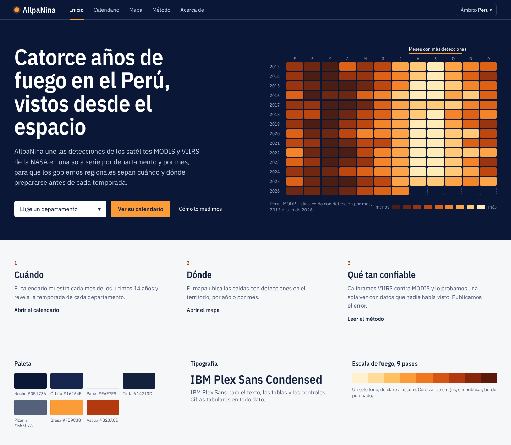

# AllpaNina — Plan de rediseño y refactorización del frontend

- **Fecha:** 15-nov-2026
- **Rama:** `refactor/frontend-redesign`, creada desde `feat/peru-integration`. Ya incluye `feat/region-mundial` (`34d00a9`), fusionada sin conflictos.
- **Ajustes v2 (15:50):** se incluye «Mi región» y **toda la interfaz pasa a inglés**. Ver B7 y B8.
- **Base:** `AUDITORIA_FRONTEND.md`. Los códigos C1, D4, T1… remiten a sus hallazgos.
- **Maqueta de referencia:** `img/propuesta-inicio.png`, hecha con datos reales del Perú (MODIS, 2013 a julio de 2026).
- **Relación con el plan anterior:** continúa `docs/frontend/PLAN_C2.md` de Marco, cuya fase 1 ya está hecha (portada, títulos por ruta, metadatos) y cuyas fases 2 y 3 no se ejecutaron. Este plan las reemplaza en lo visual y respeta sus reglas: no cambia ninguna cifra publicada ni anuncia nada que la web no muestre hoy. Los dos cambios que tocan `services/data/` (caché y clases por cuantiles) son solo agregados y se coordinan con Landry.



---

# Parte A — Plan de diseño

## A1. El concepto

**El satélite ve el fuego de noche, como puntos de luz sobre la tierra oscura.** AllpaNina significa «tierra y fuego» en quechua, y el diseño se construye sobre esa imagen:

- La **tierra**, el marco: un azul noche institucional, el mismo del logo.
- El **fuego**, el dato: una escala de color que va de brasa apagada a llama clara.

Todo lo que no es dato se queda quieto y sobrio, como en FIRMS: barra plana, paneles limpios, tipografía técnica. **El único elemento llamativo es el dato.**

**La pieza memorable** es el **calendario de 14 años**: una matriz de años por meses donde la temporada de agosto a octubre se enciende sola. Va como portada en el inicio y es el corazón de la página Calendario. No es decoración: es el producto mostrando su resultado principal en el primer segundo.

### Por qué no seguir con el diseño actual
El sitio actual usa fondo crema (`#F9F7F2`) con un acento terracota (`#E77648`). Es la combinación más repetida en las webs generadas hoy, y por eso se ve genérica. Además, su verde no tiene relación con el logo, que es azul noche y blanco.

## A2. Sistema visual

### Colores de marco

| Nombre | Hex | Uso |
|---|---|---|
| Noche | `#0B1736` | Barra superior, portada, mapa, pie de página. Es el azul del logo |
| Órbita | `#16264F` | Paneles y tarjetas sobre fondo oscuro |
| Línea | `#2A3B66` | Bordes sobre fondo oscuro; celdas en cero sobre fondo oscuro |
| Papel | `#F6F7F9` | Fondo de las páginas de lectura (Calendario, Método, Acerca de). Es frío, no crema |
| Tinta | `#14213D` | Texto principal: 14,9:1 sobre Papel |
| Pizarra | `#55607A` | Texto secundario: 5,9:1 sobre Papel |
| Brasa | `#FB9C38` | Botón principal sobre fondo oscuro, con texto en Tinta (8,3:1 contra Noche) |
| Ascua | `#B23A0E` | Botón principal sobre fondo claro, con texto blanco (6,0:1); enlaces de acción |

### Escala de fuego (magnitud)
Un solo tono, 9 pasos, validados. El claro varía de forma monótona en los 9, y el texto dentro de cada celda alterna entre Tinta y blanco según el contraste, de 4:1 a 15:1.

| | 1 | 2 | 3 | 4 | 5 | 6 | 7 | 8 | 9 |
|---|---|---|---|---|---|---|---|---|---|
| **Sobre Papel** (menos → más) | `#FFF1D0` | `#FFDC9A` | `#FFC062` | `#FB9C38` | `#EF781E` | `#D65512` | `#B23A0E` | `#86270C` | `#5A1909` |
| **Sobre Noche** (menos → más) | `#4A1E14` | `#6E2812` | `#96350F` | `#BE4710` | `#DE6216` | `#F3842A` | `#FCA548` | `#FFC977` | `#FFEBB8` |

- **Sobre fondo oscuro la escala se invierte:** lo intenso es claro, como brasas que brillan. La primera versión de la maqueta usaba la escala clara sobre el azul noche, y los meses de más fuego se perdían contra el fondo.
- **Estados que no son magnitud:**
  - **Cero válido:** gris neutro (`#E3E6EC` sobre Papel, Línea sobre Noche), con el número «0».
  - **Sin dato:** rayado diagonal.
  - **No publicado:** solo un borde punteado.

  Así nunca dependen solo del color.
- **Clases por cuantiles (9),** calculadas por región y por sensor sobre todos sus meses con detección. La leyenda muestra los rangos en números enteros. Esto corrige C1: el máximo ya no mezcla sensores ni aplasta los años tranquilos.

### Tipografía
- **IBM Plex Sans Condensed** (500 y 600) para titulares, cifras grandes y rótulos de ejes. Es técnica e institucional, cercana al lenguaje de las agencias espaciales, y la versión condensada permite números grandes en celdas pequeñas.
- **IBM Plex Sans** (400, 500 y 600) para el texto, los controles y las tablas. Las cifras van siempre con `font-variant-numeric: tabular-nums`.
- **Fuentes autoalojadas** con `@fontsource`, sin CDN: no dependen de Google Fonts el día del jurado. Esto corrige D2.
- **Escala tipográfica (razón 1,25):** 13 · 15 · 16 (base) · 19 · 24 · 30 · 38 · 48 · 64 px. Nada por debajo de 13 px, lo que corrige D3. Líneas de texto de 60 a 75 caracteres.

### Forma y espacio
- **Espaciado en múltiplos de 4 px.** Márgenes laterales de 40 px en escritorio y 16 px en móvil.
- **Radios con jerarquía:** 3 px en celdas de datos, 6 px en controles y botones, 10 px en paneles. Nada de «píldoras».
- **Sombras solo en lo que flota sobre el mapa** (paneles, menús). El resto separa con líneas de 1 px.
- **Movimiento:** solo como respuesta a una acción (abrir un panel, cambiar de año). La única animación que no depende del usuario es el encendido del calendario de la portada al cargar: las celdas aparecen de enero a diciembre en 600 ms. Se desactiva con `prefers-reduced-motion`.

### Voz
- **Nombres, no códigos:** «Cusco», nunca «PE-08» (corrige C3). Los códigos solo aparecen en las descargas.
- **Cifras en formato peruano:** «25 046», sin decimales en los conteos, y fechas como «jul 2026».
- **Nada interno en pantalla:** ni «contrato», ni `DECISIONS.md`, ni «P11», ni rutas de `docs/` (corrige C2). Lo técnico va en «Detalle técnico», plegado, con lenguaje de lector.
- **Frases cortas y en voz activa.** Los botones dicen lo que hacen: «Ver su calendario», «Descargar CSV».

## A3. Estructura y navegación

```
Inicio ──► Calendario ──► Mapa
  │            │            │
  └────────────┴──► Método ◄┘        Acerca de (equipo, créditos, IA)
```

- **Flujo principal: «Elige un departamento» → su calendario → «Ver este mes en el mapa» → «¿Qué tan confiable es?».** Cada página termina con el siguiente paso.
- **El ámbito vive en la barra superior** («Ámbito: Perú ▾»), igual en todas las páginas, y viaja en la URL como hoy. Corrige D7: ya no hay un selector suelto flotando sobre el mapa.
- **«Piloto v1.0» sale de la vista principal** (C6). Se mueve a Acerca de, en «Versiones anteriores».

### Barra superior (todas las páginas)
```
┌──────────────────────────────────────────────────────────────────────────┐
│ ● AllpaNina   Inicio  Calendario  Mapa  Método  Acerca de   [Ámbito Perú ▾]│  56 px, Noche, plana y fija
└──────────────────────────────────────────────────────────────────────────┘
```
- En móvil: logo, ámbito y un menú hamburguesa que abre un panel a pantalla completa. Así la barra ocupa una sola fila, no dos (corrige D8).

### Pie de página (todas menos Mapa)
Fondo Noche, en tres columnas:
- **Datos:** NASA FIRMS (texto de reconocimiento oficial), INEI, MINAM, Esri.
- **Proyecto:** equipo, NASA Space Apps 2026, repositorio.
- **Uso:** «Prototipo científico. No usar para decisiones tácticas.»

Corrige D5.

## A4. Pantallas

### Inicio (`/`)
Ver la maqueta.
```
┌ Noche ─────────────────────────────────────────────────────────────────┐
│ Titular grande (Plex Condensed 64)      │  Calendario de 14 años, Perú   │
│ Bajada: qué es y para quién (2 líneas)  │  (escala oscura, con          │
│ [Elige un departamento ▾] [Ver su       │   «Meses con más detecciones») │
│  calendario]   Cómo lo medimos          │  Leyenda menos → más           │
└──────────────────────────────────────────────────────────────────────────┘
│ 1 Cuándo      │ 2 Dónde        │ 3 Qué tan confiable                    │  la numeración es real: es el recorrido
├──────────────────────────────────────────────────────────────────────────┤
│ Para quién: gobiernos regionales que planifican la prevención (texto      │
│ breve + una cifra: «14 años · 25 departamentos · 2 satélites»)            │
├──────────────────────────────────────────────────────────────────────────┤
│ Lo que estos datos no dicen (se conserva, con mejor tipografía)           │
└ Pie de página ───────────────────────────────────────────────────────────┘
```
- **El calendario de la portada es interactivo:** al pasar el cursor por una celda muestra «ago 2024 · 4 200 días-celda», y al hacer clic abre ese mes en el Calendario.
- **Móvil:** el titular va arriba y el calendario debajo, ocupando todo el ancho, con las iniciales de los meses.

### Calendario (`/calendario`)
```
┌ Papel ─────────────────────────────────────────────────────────────────┐
│ Cusco  ·  Calendario de detecciones          [MODIS | VIIRS | Estimado]  [Descargar CSV] │
│ Resumen: «Meses de más actividad: agosto–octubre. Año más intenso: ‹año›» │
├───────────────────────────────────────────────┬──────────────────────────┤
│ Matriz 14 años × 12 meses (escala clara),     │ Panel del mes elegido:   │
│ número dentro de cada celda (Plex Condensed)  │ ago 2024 · Cusco         │
│ año parcial marcado; fila elegida resaltada   │ MODIS 4 200 · VIIRS 16 9xx│
│ Leyenda por cuantiles con rangos enteros      │ Estimado B1 + su error   │
│                                               │ [Ver este mes en el mapa]│
└───────────────────────────────────────────────┴──────────────────────────┘
│ Análisis histórico (se conserva el de Landry, debajo, con el nuevo estilo) │
```
- **La matriz completa reemplaza a «un año + comparar años»:** la comparación ya está a la vista. Esto corrige C1, C5 y C10.
- **Al abrir, el panel derecho no está vacío:** muestra el mes más intenso del último año completo. Así no hay un «Selecciona un mes» en la primera vista.
- **El rótulo «Estimado»** remite a B1, con su error de test al lado. Nunca se presenta como dato observado.
- **El texto técnico del CSV** (C11) pasa a la descripción del botón de descarga.

### Mapa (`/mapa`), inspirado en FIRMS
```
┌ Barra superior ──────────────────────────────────────────────────────────┐
├────────────┬─────────────────────────────────────────────────────────────┤
│ Panel 340px│                                                             │
│ [Explorar | Capas | Info]                     MAPA (pantalla completa)   │
│ Sensor     │                                                             │
│ Resumen del│                                          ┌ Leyenda ───────┐ │
│ período    │                                          │ escala oscura  │ │
│ Celda      │                                          └────────────────┘ │
│ elegida    │  ┌ Línea de tiempo: 2013 … 2026 · E F M A M J J A S O N D ┐  │
└────────────┴──┴──────────────────────────────────────────────────────────┴┘
```
- **Panel izquierdo plegable** con pestañas, como el modo Basic de FIRMS. Sobre el mapa solo quedan la leyenda y la línea de tiempo.
- **Línea de tiempo abajo:** años y meses en una sola franja, con la intensidad de cada mes como mini barra. El usuario ve en qué meses hay algo antes de hacer clic.
- **Si falla un fondo, el mapa sigue funcionando** (C4): cambia solo al siguiente fondo (Blue Marble → Firefly → Topográfico → ninguno) y avisa con una nota pequeña, por ejemplo «Fondo satelital no disponible; se muestra el topográfico». Nunca más un error con una URL.
- **Las celdas usan la escala oscura** sobre el fondo satelital oscurecido. Las áreas protegidas se muestran para todo el Perú (C7), y se corrige el icono que falta (C12).
- **Móvil:** el mapa a pantalla completa, con una hoja inferior de tres alturas (resumen, medio, completo) y la línea de tiempo dentro de la hoja.

### Método (`/metodo`)
```
┌ Papel ─────────────────────────────────────────────────────────────────┐
│ Índice fijo │ Titular + bajada: «Cómo medimos y cuánto nos equivocamos» │
│ (izquierda) │ 1 Qué se cuenta (día-celda, con un diagrama de celda×día) │
│             │ 2 Por qué hay que calibrar (MODIS vs VIIRS, gráfico)      │
│             │ 3 Cómo lo probamos (línea entrenamiento/validación/prueba) │
│             │ 4 Resultado: WAPE B0 vs B1 en validación y en test,       │
│             │   para la región elegida, con la lectura honesta del test │
│             │ 5 Límites (los 19, en lenguaje claro)                     │
│             │ 6 Fuentes y descargas                                     │
│             │ [Detalle técnico ▸] plegado en cada sección               │
└──────────────────────────────────────────────────────────────────────────┘
```
- **Texto para público, sin referencias internas** (C2). Las cifras se siguen leyendo de `method.json` y `validation.json`. Lo que cambia es el texto que las rodea, no los datos.
- **Gráfico de resultado:** barras horizontales finas de B0 y B1, una para validación y otra para test, en un solo eje. Va acompañado de la frase que el jurado necesita: «En 2025-2026 B1 sobreestimó a MODIS en todos los meses: lo publicamos como límite».

### Acerca de (`/acerca`), nueva
Corrige D9. Contiene:
- qué es AllpaNina y para quién;
- el equipo (los 6 integrantes y sus roles);
- NASA Space Apps 2026;
- los créditos completos;
- la declaración de uso de IA;
- las versiones anteriores, con el piloto de Ucayali v1.0.

### 404
Una frase y tres enlaces, con el mismo estilo.

## A5. Accesibilidad (el piso mínimo)
- Contraste AA en todo el texto: los pares de colores ya están medidos en A2.
- Foco visible: anillo Brasa de 2 px con 2 px de separación.
- Los estados de dato nunca dependen solo del color: hay número, rayado o borde.
- Las celdas del calendario son botones con nombre accesible («agosto 2024, 4 200 días-celda»). La matriz tiene una vista de tabla alternativa para lectores de pantalla.
- `prefers-reduced-motion` respetado; se mantiene el enlace «Saltar al contenido».

---

# Parte B — Plan de refactorización

## B1. Principios
1. **No se toca la ciencia.** `services/data/*` (validadores, cargadores, cálculos) y `types/` se conservan. Solo se agregan funciones: clases por cuantiles, nombres de región y caché.
2. **La web nunca deja de funcionar.** Se migra una pantalla a la vez; cada fase termina con `lint`, `test` y `build` en verde y la web navegable.
3. **Tailwind para todo lo nuevo; CSS donde Tailwind no llega,** sin culpa. Eso incluye MapLibre, sus controles, el rayado de «sin dato» y la animación del calendario.
4. **Las 185 pruebas siguen en verde.** Si alguna verifica un texto que cambia, se actualiza el texto esperado, pero nunca se debilita una prueba de datos.
5. **Código legible:** una idea por línea; los archivos que se tocan se reformatean (T3). Los que no se tocan se dejan como están, para no generar conflictos con el equipo.

## B2. Nueva estructura de `src/`
```
src/
  app/            AppRoutes (con React.lazy por ruta), layouts, hooks de URL   ← se conserva y se amplía
  ui/             piezas reutilizables con Tailwind:
                  Button, Select, Tabs, Disclosure, Stat, Legend, FireScale,
                  Panel, Toast, PageHeader, Section, ExternalLink
  shell/          TopBar, ScopePicker (ámbito), MobileMenu, Footer
  features/
    landing/      LandingPage, HeroCalendar
    calendar/     CalendarPage, YearMonthMatrix, MonthPanel, HistoricalAnalysis (de Landry)
    map/          MapPage, MapSidebar, TimeBar, MapLegend, basemapFallback.ts, map.css
    method/       MethodPage, secciones, ResultChart
    about/        AboutPage
  services/data/  ← sin cambios, más: fireClasses.ts, regionNames.ts, cache en loaders.ts
  types/          ← sin cambios
  styles/         app.css (@import "tailwindcss"; @theme con los tokens de A2), fonts.css
```

## B3. Fases

Las horas son estimadas. **La entrega cierra hoy a las 23:59**, así que hay una línea de corte.

| Fase | Qué | Archivos principales | Aceptación | Horas |
|---|---|---|---|---|
| **F0 · Base** | Traer las 4 correcciones de `fase2`. Regenerar `package-lock.json` contra `registry.npmjs.org` (T1). Corregir el error de lint de `mundo.ts`, que viene de `region-mundial`. Activar Tailwind con `@theme` y los tokens de A2. Instalar las fuentes de `@fontsource`. Agregar caché a los cargadores (T5) | `package*.json`, `styles/`, `loaders.ts`, `mundo.ts` | `npm ci` en menos de 1 minuto desde cero; lint limpio; 206 pruebas en verde y 1 saltada (la de paridad, que ya venía saltada); build correcto | 0,5 |
| **F1 · Marco** | `TopBar` en inglés con *My region* en la navegación y el ámbito integrado, `MobileMenu`, `Footer`. Rutas en inglés con redirecciones desde las antiguas (B7). `React.lazy` por ruta (T2). `lang="en"` y metadatos para compartir (T6). Quitar el selector suelto y el «Piloto v1.0» | `shell/*`, `AppRoutes`, `MainLayout`, `index.html` | Todas las rutas navegan, incluidas las antiguas en español; el ámbito persiste en la URL; la barra ocupa una fila en móvil | 1 |
| **F2 · Inicio y Acerca de** | Portada según la maqueta, con `HeroCalendar` alimentado por `monthly_series.csv` de `PE`, más el selector de departamento. Página Acerca de | `features/landing`, `features/about`, `fireClasses.ts` | El calendario de la portada usa datos reales; clic en una celda lleva al mes correcto en el Calendario | 1,5 |
| **F3 · Calendario** | Matriz de 14 años, panel del mes, conmutador de sensor, leyenda por cuantiles, descarga, Análisis histórico con el nuevo estilo | `features/calendar/*` | Se ve la estacionalidad en Perú, Cusco y Ucayali; el primer panel no está vacío; las cifras coinciden con el CSV | 1,5 |
| **F4 · Método** | Reescribir el texto público, sin referencias internas, con «Detalle técnico» plegado. Gráfico de resultado B0/B1 en valid y test. Fuentes | `features/method/*` | Ninguna cadena `DECISIONS`, `contrato`, `P1x` ni `docs/` en pantalla (lo verifica una prueba nueva); cifras iguales a `validation.json` | 1 |
| **F4b · My region** | Adoptar el sistema visual: los 5 pasos (País → Región → Datos → Procesamiento → Resultados) como un indicador de pasos horizontal; paneles en Papel; botón principal Ascua; progreso del Worker con barra y etapa; el aviso «exploratorio» visible en Resultados. Interfaz en inglés. **Sin tocar** `services/region/*`, salvo los mensajes de error que ve el usuario (B7) | `pages/region/*` → `features/region/*`, `region.css` | El flujo completo funciona con un CSV de prueba; las pruebas `region-*` en verde; la salida es byte a byte igual a la de antes | 1 |
| **— corte —** | **Si a las 21:30 no se llegó aquí, el Mapa conserva su diseño y solo recibe F5a** | | | |
| **F5a · Mapa, lo mínimo** | Fondo de respaldo (C4), nombres en vez de códigos (C3), áreas protegidas de todo el Perú (C7), el icono que falta (C12), nuevos colores en el CSS existente | `mapConstruction.ts`, `juanLayers.ts`, `map.css` | Con GIBS bloqueado, el mapa muestra los datos sobre otro fondo | 0,5 |
| **F5b · Mapa, completo** | Panel izquierdo con pestañas, línea de tiempo, leyenda nueva, hoja inferior en móvil | `features/map/*` | Igual que hoy en funciones, más la línea de tiempo | 1,5 |
| **F6 · Revisión** | `lint`, `test` y `build`; capturas de las 5 rutas en escritorio y móvil; revisión de contraste; recorrido completo por teclado; prueba en otra PC | — | Lista de verificación de B5 completa | 0,5 |

**Total:** unas 9,5 horas con F5b y la traducción, u 8 sin F5b. Con el cierre a las 23:59 no entra todo: la línea de corte pasa a aplicarse sobre F5b, y F4b va antes que el Mapa.

## B4. Lo que queda fuera
- **Cambios en datos, κ o métricas:** todo eso está congelado desde P11 a P19.
- **Modo oscuro completo de las páginas de lectura:** solo la portada, el mapa y el pie son oscuros.

## B5. Lista de verificación final
- [ ] `npm ci && npm run lint && npm test && npm run build` en verde, desde un clon limpio.
- [ ] Ningún código de región visible fuera de las descargas.
- [ ] Ningún texto interno: `DECISIONS`, `contrato`, `P11`, `docs/`.
- [ ] El calendario de Perú, Cusco y Ucayali muestra la estacionalidad.
- [ ] El mapa funciona con GIBS bloqueado.
- [ ] El pie de página lleva el reconocimiento oficial de FIRMS, completo.
- [ ] Móvil a 390 px: sin desbordes horizontales y la barra en una fila.
- [ ] Todo se puede usar con teclado; el foco siempre se ve.
- [ ] Ningún texto de menos de 13 px.
- [ ] Ningún texto de interfaz en español, salvo los nombres propios y los textos científicos marcados (B7).
- [ ] My region: el flujo completo funciona, y la prueba de paridad con Ucayali sigue pasando con `ALLPANINA_LENTO=1`.

## B6. Cómo trabajamos juntos
- **Yo trabajo en la rama `refactor/frontend-redesign`**, en mi espacio, con un commit por fase. Hoy no puedo hacer push.
- **Al cerrar cada fase te paso los archivos.** Dos opciones:
  - los copio a la carpeta de Antonella y ustedes hacen commit y push;
  - o se me da acceso de escritura al repositorio y abro un PR por fase.
- **Antes de seguir a la fase siguiente, te mando capturas**, para que puedas corregir el rumbo a tiempo.

## B7. Inglés

- **Toda la interfaz pasa a inglés:** navegación, botones, ayudas, errores que ve el usuario, leyendas, fechas (`Aug 2024`) y números (`25,046`). `<html lang="en">`.
- **Rutas en inglés:** `/calendar`, `/map`, `/method`, `/my-region` y `/about`. Las antiguas (`/calendario`, `/mapa`, `/metodo`, `/mi-region`) redirigen, conservando los parámetros, para que los enlaces ya compartidos sigan funcionando.
- **Sin librería de idiomas:** los textos van directo en los componentes. Hoy no se pide mantener dos idiomas, y una librería sumaría trabajo sin beneficio.
- **Los nombres propios no se traducen:** Cusco, Madre de Dios, INEI y MINAM.
- **Pruebas:** 26 de los 28 archivos de prueba comparan textos en español. Se actualiza el texto esperado; ninguna comprobación de datos se quita ni se afloja.

### El punto delicado: los textos científicos
Varios textos que se ven en Método vienen de los productos científicos, no del código. Son las 19 limitaciones de `method.json` y los campos `indicator`, `filters`, `calibration`, `error_convention` y `status_rule`. Esos archivos están congelados (P17 a P19) y **no se modifican**. Para mostrarlos en inglés:

1. **El frontend tiene una traducción revisada de cada texto,** guardada junto al hash SHA-256 del `method.json` del que salió.
2. **Una prueba falla si el `method.json` publicado cambia** y su hash ya no coincide. Así una traducción nunca queda desfasada del texto científico sin que nadie lo note.
3. **Si falta una traducción, se muestra el original en español,** marcado como «(original text in Spanish)». Nunca se muestra una traducción automática.
4. **Las traducciones las revisa el equipo científico** (Aldo o Antonella) antes de entregar.

### My region
- **Los archivos que genera el Worker** (`method.json`, CSV y mapas de la región del usuario) **se quedan como están**, en español y con el mismo formato que los scripts de Python. Si se tradujeran, se rompería la paridad byte a byte con el piloto de Ucayali.
- **Lo que sí se traduce:** la página, las etapas de progreso y los mensajes de error de `firms.ts`, `descarga.ts`, `importar.ts` y `polygon.ts`. Son textos de interfaz, no del algoritmo, así que cambiarlos no altera ningún resultado. Las pruebas `region-*` que comparan esos mensajes se actualizan.

## B8. Orden ajustado para hoy

F0 → F1 → F2 → F3 → F4 → **F4b (My region)** → F5a → (F5b si hay tiempo) → F6.

La traducción no es una fase aparte: cada pantalla se rediseña y se traduce a la vez, para tocar cada archivo una sola vez.
